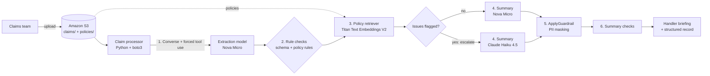

# Insurance claims processing on Amazon Bedrock

A proof-of-concept that reads insurance claim documents from Amazon S3, extracts structured
fields, checks them against the policy, retrieves the relevant policy clauses (RAG), writes a
handler briefing with a coverage verdict, and masks PII with Amazon Bedrock Guardrails.

Built as the bonus assignment for **AWS Certified Generative AI Developer - Professional
(AIP-C01), Task 1.1: Analyze requirements and design GenAI solutions**.

**Headline result:** routing each claim to a small model and escalating only the claims that
the rule checks flag to a larger model matched the larger model's accuracy on every metric,
at **84% lower cost and 39% lower latency** (see [Results](#results)).

## Architecture (Skill 1.1.1)



| Stage | Model or service | Why |
|---|---|---|
| Document storage | Amazon S3 (SSE-S3, public access blocked, TLS-only, 7-day lifecycle) | Durable, event-capable store; the lifecycle rule is a cleanup safety net |
| Document understanding and extraction | Amazon Nova Micro, Converse API with a forced tool call | Extraction is a narrow, schema-bound task. Forcing the tool makes every model return arguments that match the JSON schema, so the small model scored 100% |
| Policy retrieval | Amazon Titan Text Embeddings V2 (512-dim, normalised) | Low cost; 512 dimensions are plenty for short policy clauses |
| Summary and coverage reasoning | Nova Micro by default, **Claude Haiku 4.5 when rules flag the claim** | Reasoning over conflicting evidence is where the small models failed (see Results) |
| Response safety | Amazon Bedrock Guardrails (ApplyGuardrail, sensitive-information filters) | Masks SSNs, card and bank numbers, emails, phones and addresses before a summary is shared |

### Key design decisions

- **Converse API, not InvokeModel.** The course sample uses `InvokeModel` with the legacy Claude
  v2 text-completion body, so every provider needs its own request and parsing code. Converse
  has one schema for every model, returns token usage and latency, and standardises tool use.
  That is what turns the model comparison into a one-line change.
- **Inference profiles.** Current models are called through cross-Region inference profile IDs
  (`us.anthropic...`, `us.amazon.nova...`) for higher throughput.
- **Structured output through tool use.** The extraction step forces a `record_claim` tool whose
  input schema is the claim schema, instead of asking for "JSON format" in the prompt.
- **Validate, then generate.** Deterministic checks (ISO dates, positive amount, policy exists,
  incident inside the coverage period, amount within the limit, claim type matches the policy)
  run before the summary. Their results are passed to the model as grounding and used to route it.
- **Prompt-injection boundary.** Claim text is wrapped in `<document>` tags, and the system
  prompt says it is data, not instructions.
- **ApplyGuardrail as a separate step.** Extraction needs the raw values, so the guardrail is
  applied only to the summary that is shared more widely. ApplyGuardrail is model-independent
  and works on text from any source.
- **Infrastructure as code.** One CloudFormation stack, created with `scripts/deploy.sh` and fully
  removed with `scripts/teardown.sh`. Nothing in the stack costs money while idle.

## Reusable components (Skill 1.1.3)

| Component | File | What it does |
|---|---|---|
| Prompt template manager | [`claims_poc/prompts.py`](claims_poc/prompts.py) | Named, versioned templates; strict missing/extra variable checks; `$var` syntax so braces in documents are safe. Mirrors Bedrock Prompt Management concepts |
| Model invoker | [`claims_poc/invoker.py`](claims_poc/invoker.py) | One Converse wrapper for all models: bounded `maxTokens`, adaptive retries, forced tool use, token/latency/cost metrics |
| Content validator | [`claims_poc/validator.py`](claims_poc/validator.py) | Schema and business-rule checks on extracted fields; summary checks (verdict present, word budget, leftover PII, verdict consistent with rule flags) |
| Policy retriever | [`claims_poc/rag.py`](claims_poc/rag.py) | Heading-based chunking, Titan V2 embeddings, policy-number metadata filter, multi-query retrieval |
| Evaluator | [`claims_poc/evaluate.py`](claims_poc/evaluate.py) | Scores runs against hand-labelled ground truth and writes the comparison report |

## Results

Three synthetic claims ([`data/claims`](data/claims)) designed to get harder:
a clean auto claim form; a free-text home claim email with a lower-case policy number, the date
in words, a distractor amount and PII in the signature; and a messy travel claim with a DD/MM
date, two incidents, a total above the policy limit, and an SSN and a card number in the body.

| Model | Field accuracy | Verdict agreement | Rule flags caught | Mean latency | Cost / claim | Cost / 10k claims |
|---|---|---|---|---|---|---|
| **Nova Micro, escalate to Haiku 4.5** | 100% | **100%** | 100% | **1,732 ms** | **$0.00060** | **$6.03** |
| Nova Lite, escalate to Haiku 4.5 | 100% | 100% | 100% | 2,370 ms | $0.00071 | $7.08 |
| Claude Haiku 4.5 | 100% | 100% | 100% | 2,820 ms | $0.00382 | $38.20 |
| Nova Micro | 100% | 67% | 100% | 1,391 ms | $0.00008 | $0.78 |
| Nova Lite | 100% | 67% | 100% | 1,819 ms | $0.00013 | $1.31 |

Full per-claim output, including every generated summary: [`results/comparison.md`](results/comparison.md).
Latency is the sum of the extraction and summary model calls reported by Converse. Cost uses
on-demand us-east-1 list prices and leaves out the few cents of embedding and guardrail charges.

### Findings

1. **Extraction is solved by schema, not model size.** With forced tool use, all three models
   extracted every field correctly, including "pol-200871", "Saturday 3 October 2026" and
   "22/07/2026", and ignored the distractor amount.
2. **Reasoning is where small models fail.** On the over-limit travel claim, Nova Lite returned
   LIKELY COVERED while noting that the amount exceeded the limit. Nova Micro returned LIKELY NOT
   COVERED and invented a medical exclusion. Haiku 4.5 correctly returned NEEDS REVIEW.
3. **Cascading gets the best of both.** The rule checks are deterministic and run before the
   summary, so they are a free routing signal. Escalating only the flagged claims kept Haiku's
   accuracy at about one sixth of its cost.
4. **One query can miss parts of a multi-incident claim.** A single embedding of "suitcase stolen
   and a fall needing hospital treatment" retrieved Baggage, Exclusions and Trip Cancellation,
   but not **Emergency Medical**, and the summary then wrongly said medical costs were not
   covered. Splitting the description into sentences and merging the per-query results
   (multi-query retrieval) fixed it.
5. **Guardrails trade recall for precision.** The `ADDRESS` filter correctly masked the street
   address, but it also masked the city name "Lisbon". For a claims team that may be acceptable.
   For other audiences, a custom regex filter or a narrower entity list would be better.

**Caveat:** three documents are enough to show the patterns, not to prove them. A production
evaluation would use hundreds of labelled claims, LLM-as-a-judge scoring of summary quality
(for example Amazon Bedrock Evaluations), and confidence intervals.

## Run it

Prerequisites: Python 3.10+, the AWS CLI, an AWS account with Bedrock model access in us-east-1,
and credentials in your environment (`AWS_PROFILE`, `AWS_REGION`).

```bash
pip install -r requirements.txt
python -m unittest discover -s tests -t .      # offline unit tests

./scripts/deploy.sh                            # S3 bucket + guardrail stack, uploads sample data
python -m claims_poc process claims/claim-003-travel.txt --model nova-micro --escalate-to haiku-4.5
python -m claims_poc compare                   # all models + cascades -> results/

./scripts/teardown.sh                          # empties the bucket and deletes the stack
```

A full comparison run (15 pipeline runs) costs about $0.02.

## Next steps

- Replace the in-memory retriever with **Amazon Bedrock Knowledge Bases** on S3 Vectors, with
  `policy_number` metadata filtering
- Trigger processing from **S3 event notifications to AWS Lambda**, and run the multi-step flow on
  **AWS Step Functions** with a human-review state for NEEDS REVIEW claims
- Support PDFs and scanned forms with **Amazon Bedrock Data Automation** or Amazon Textract
- Add a feedback endpoint for handler corrections, and grow them into an evaluation dataset

## Disclaimer

Educational project. All people, policies and claims are fictitious. Running it creates AWS
resources that may incur charges; run the teardown script when you are finished.
